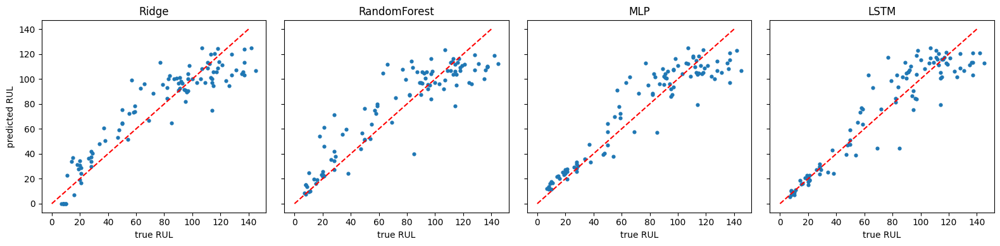

# Remaining Useful Life Prediction on NASA C-MAPSS (Ridge vs Random Forest vs MLP vs LSTM)

Predict how many flights a jet engine has left before it fails, using its recent sensor readings.
This project compares four models on the same data and the same evaluation:
Ridge regression, Random Forest, a plain neural network (MLP) and a 2-layer LSTM.

[](https://colab.research.google.com/drive/1mECcPblve1pnikn4k1SsclOWenCtTVms?usp=sharing)

## Results (FD001 test set, 100 engines)

| Model | Val RMSE | Test RMSE | Test RMSE (true RUL capped at 125) | NASA score |
|---|---|---|---|---|
| Ridge | 16.78 | 16.05 | 14.66 | 411 |
| Random Forest | 16.34 | 17.79 | 16.50 | 648 |
| MLP | 13.23 | 15.00 | 13.44 | 339 |
| LSTM | 12.28 | 14.71 | 13.57 | 377 |

Lower is better for every column. These are single-seed results, and the MLP and LSTM are
close enough that the gap between them should not be treated as a clear win.
See [REPORT.md](REPORT.md) for the full explanation, discussion and limitations.



## Quick start

```bash
git clone https://github.com/Hossein-Mosaffa/predictive-maintenance.git
cd predictive-maintenance
pip install -r requirements.txt
```

1. Download the C-MAPSS data from the [NASA Prognostics Data Repository](https://data.nasa.gov/dataset/cmapss-jet-engine-simulated-data).
2. Copy `train_FD001.txt`, `test_FD001.txt` and `RUL_FD001.txt` into the `data/` folder.
3. Run:

```bash
python predictive-maintenance.py
```

Results (`results.csv`, `pred_vs_true.png`) are written to `results/`.
You can also open `predictive-maintenance.ipynb` in Google Colab (use the badge above) and upload the three files in the first cell.

## What is in this repo

| File | Purpose |
|---|---|
| `predictive-maintenance.py` | Full pipeline: data, windows, 4 models, metrics, plot |
| `predictive-maintenance.ipynb` | Same code as a Colab notebook with explanations |
| `REPORT.md` | Written report |
| `results/` | Results table and plot |
| `data/` | Put the NASA files here (not included in the repo) |

## Method in short

- Label: flights remaining until failure, capped at 125 (the usual convention for C-MAPSS).
- Input: the last 30 flights of 14 sensors, scaled to 0-1 using training data only.
- Validation: 20 whole training engines held out (windows are never split across engines).
- Test: the last 30 flights of each of the 100 NASA test engines, compared with the official answer file.
- Metrics: RMSE and the NASA asymmetric score.
