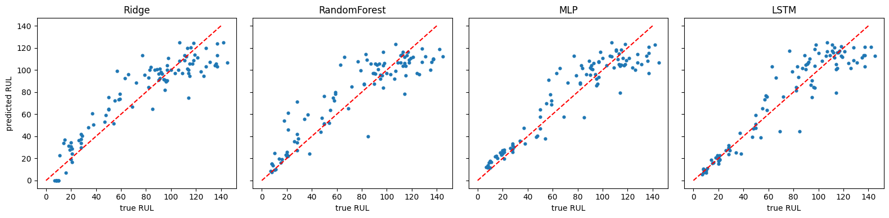

# Remaining Useful Life Prediction on NASA C-MAPSS: A Comparison of Ridge, Random Forest, MLP and LSTM

## 1. Introduction (in plain words)

### The problem

Machines wear out. A factory or an airline wants to fix a machine before it breaks, but not too early,
because that wastes money and good parts. Breaking during use is worse. So the question is:
how much longer will this machine last? That number is called the Remaining Useful Life, or RUL.
Here it is measured in flights (also called cycles).

### The data

NASA simulated 100 jet engines and ran each one until it broke. During every flight, 21 sensors
recorded values such as temperatures and pressures. The data is a big table: each row is one flight of one
engine, and each column is one sensor. As an engine wears out, some sensors drift slowly, so the rows from a
healthy engine look a little different from the rows of a worn one. The drift is small and noisy, which is
why a learning model is useful.

### The task

We give a model the last 30 flights of an engine, and it tells us how many flights are left. A doctor does
something similar when looking at a patient's last few checkups to estimate how a condition is progressing:
the trend over time tells the story, not one reading.

For the training engines we know when each one broke, so we can work out the right answer at every moment.
If an engine broke at flight 200, it had 50 flights left at flight 150. That known answer is called the label.
We cap the label at 125, because early in an engine's life the sensors look about the same whether 200 or 150
flights remain, so there is nothing useful to learn from that difference.

### How we check a model

NASA also provides 100 test engines whose histories stop before failure, plus an answer file with the true
remaining flights. The models never train on these. We feed in the last 30 flights of each test engine,
collect 100 predictions and compare them with the answer file. The main score is RMSE, the typical size of
the error in flights. Lower is better: an RMSE of 15 means predictions are typically about 15 flights off.
We also report the NASA score, which punishes late predictions (saying an engine has more life than it does)
more than early ones, because a late prediction is the dangerous one.

### The four methods

- **Ridge regression** draws a straight-line formula over the 420 numbers in the window (30 flights x 14 sensors).
  Each number gets a weight and the weighted numbers are added up. It is fast and cannot learn curves.
- **Random Forest** is many decision trees voting. Each tree asks yes/no questions such as "is sensor 11 above 0.6?"
  and the forest averages the answers. It can learn curves, but it treats the 420 numbers as an unordered list.
- **MLP (plain neural network)** also takes the flattened 420 numbers and passes them through layers of weighted sums and
  non-linear steps. It can learn complex patterns but does not know that the numbers are in time order.
- **LSTM** reads the 30 flights one by one, in order, and keeps a memory of what it has seen. It is built for sequences,
  so it can learn a trend directly. We stack two LSTM layers so the second can combine patterns found by the first.

## 2. Data

- Dataset: NASA C-MAPSS, subset FD001 (one operating condition, one fault mode: high-pressure compressor degradation).
- 100 training engines run to failure, with lifetimes from 128 to 362 flights (mean about 206).
- 100 test engines with histories cut off before failure (31 to 303 flights); true RUL in a separate file.
- Each row has 26 columns: engine ID, cycle, 3 operating settings and 21 sensors.

Preprocessing:
- Seven sensors and the three operating settings barely change in FD001, so they carry no information. We kept the 14
  sensors that vary: s2, s3, s4, s7, s8, s9, s11, s12, s13, s14, s15, s17, s20, s21.
- Min-max scaling to the 0-1 range, fitted on training data only.
- RUL label capped at 125 flights.
- Sliding windows of 30 flights, built inside each engine so no window mixes two engines.
  This gives 17,731 training windows (input shape 30 x 14).
- Validation set: 20 whole engines held out from the training file. The remaining 80 engines are used for training.
  Splitting by engine avoids leakage, because neighbouring windows of one engine overlap by 29 flights.
- Test input: the last 30 flights of each test engine.

## 3. Models and training

| Model | Input | Settings |
|---|---|---|
| Ridge | 420 flattened numbers | alpha = 1.0 |
| Random Forest | 420 flattened numbers | 100 trees, max depth 14, min leaf 5, 15% of features per split, trained on every 3rd window for speed |
| MLP | 420 flattened numbers | 420 -> 128 -> 64 -> 1, ReLU, dropout 0.2 |
| LSTM | 30 x 14 sequence | 2 layers, 64 hidden units, dropout 0.2, linear head on the last time step |

The two neural networks share one training function: Adam optimiser (learning rate 0.001), batch size 128,
mean squared error loss, gradient clipping at 1.0, and early stopping on validation RMSE (patience 20,
at least 30 epochs, best weights restored). Targets are scaled to 0-1 during training and converted back
to flights for evaluation.

One lesson from development: a first LSTM run without target scaling and with short patience stopped early and predicted
roughly the same value (about 80) for every engine, giving a test RMSE above 41. Scaling the targets and allowing more
training epochs fixed it.

## 4. Results

| Model | Val RMSE | Test RMSE | Test RMSE (true RUL capped at 125) | NASA score | Train time (s) |
|---|---|---|---|---|---|
| Ridge | 16.78 | 16.05 | 14.66 | 411 | 0.3 |
| Random Forest | 16.34 | 17.79 | 16.50 | 648 | 13.8 |
| MLP | 13.23 | 15.00 | 13.44 | 339 | 7.7 |
| LSTM | 12.28 | 14.71 | 13.57 | 377 | 26.6 |

Each point in the figure is one test engine. Points on the red dashed line are perfect predictions.

## 5. Discussion

- The two neural networks clearly beat the two classic models on validation RMSE (about 12-13 versus 16-17),
  and they also do better on the test set.
- The LSTM has the lowest validation and test RMSE, and the MLP has the lowest NASA score and the lowest capped test RMSE.
  The gap between them is small (0.3 flights of test RMSE), and these are single-seed results on 100 test engines,
  so this study does not show that the LSTM is better than a flattened-window MLP on FD001.
- The LSTM costs about three times more training time than the MLP for no clear gain here.
- Ridge, Random Forest and, to a lesser degree, the neural networks underestimate engines that still have a lot of life
  (the right side of the plots), partly because labels are capped at 125 and early life is hard to distinguish.
- Predictions for engines close to failure (true RUL under about 40) are the most useful for maintenance, and the MLP
  and LSTM track the true values most closely in that range.
- Random Forest was trained on a third of the windows and with a small forest to save time, so its result is a
  conservative estimate of what that method can do.

## 6. Limitations and next steps

- Single random seed and single validation split. Repeating each neural model over several seeds and reporting mean and
  standard deviation would show whether the MLP-LSTM difference is real.
- Only FD001 (one operating condition). FD002 to FD004 have multiple conditions and fault modes and are harder.
- Hyperparameters (window size 30, cap 125, hidden size 64, two layers) were not tuned. Sensible experiments are caps of
  100, 125 and 150, and 1, 2 and 3 LSTM layers.
- Possible extensions: GRU or 1D-CNN models, attention, and uncertainty estimates for the predictions.

## 7. Reproducing this work

See the README for setup. The full pipeline is in `predictive-maintenance.py`, and the Colab notebook runs the same steps.

## 8. References

- NASA Prognostics Data Repository: C-MAPSS Jet Engine Simulated Data.
  https://data.nasa.gov/dataset/cmapss-jet-engine-simulated-data
- Saxena, A., Goebel, K., Simon, D., Eklund, N. (2008). Damage propagation modeling for aircraft engine run-to-failure
  simulation. International Conference on Prognostics and Health Management. (Original C-MAPSS paper; check the citation
  details before publishing.)
